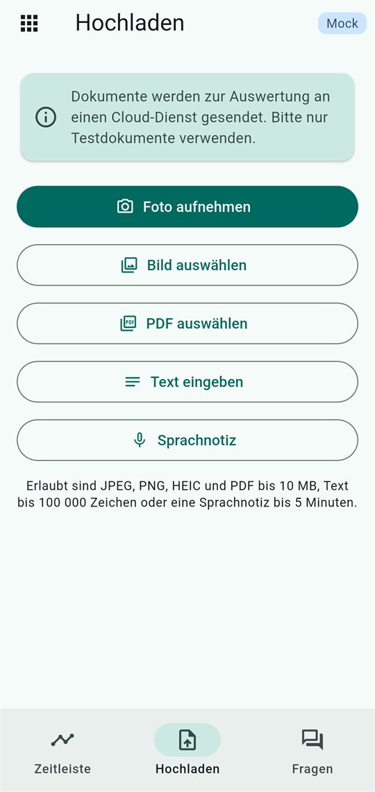
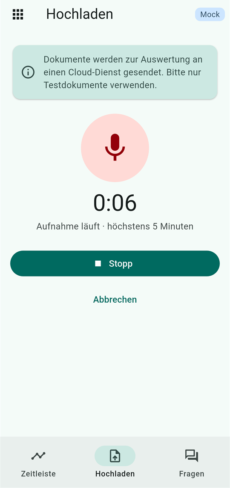
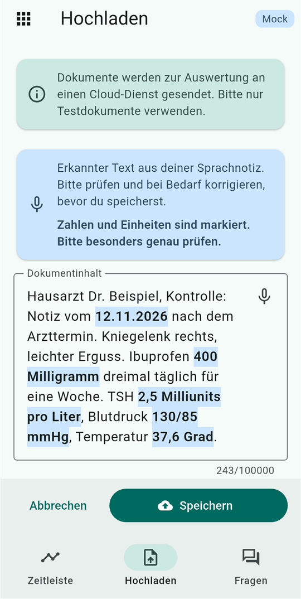
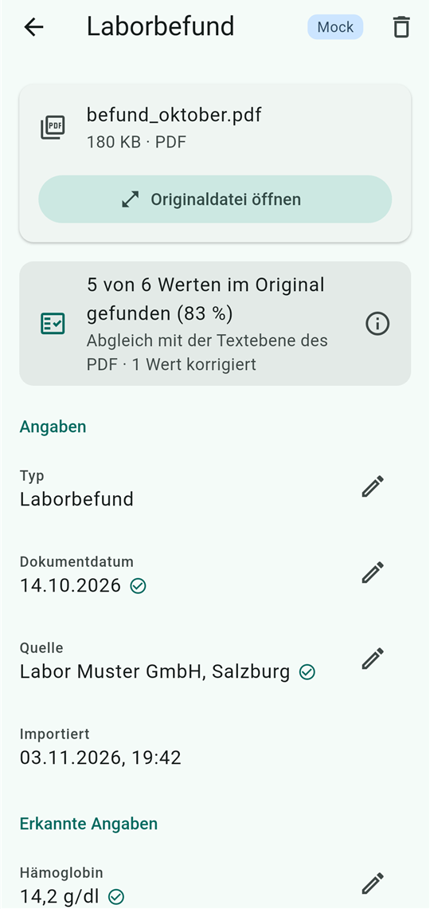
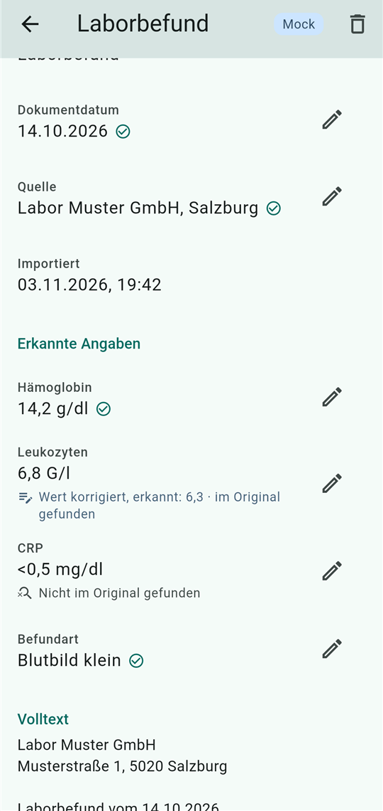
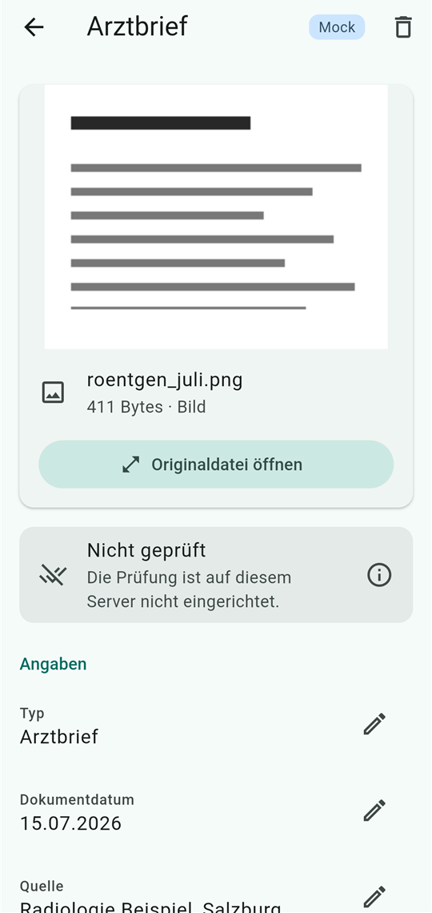
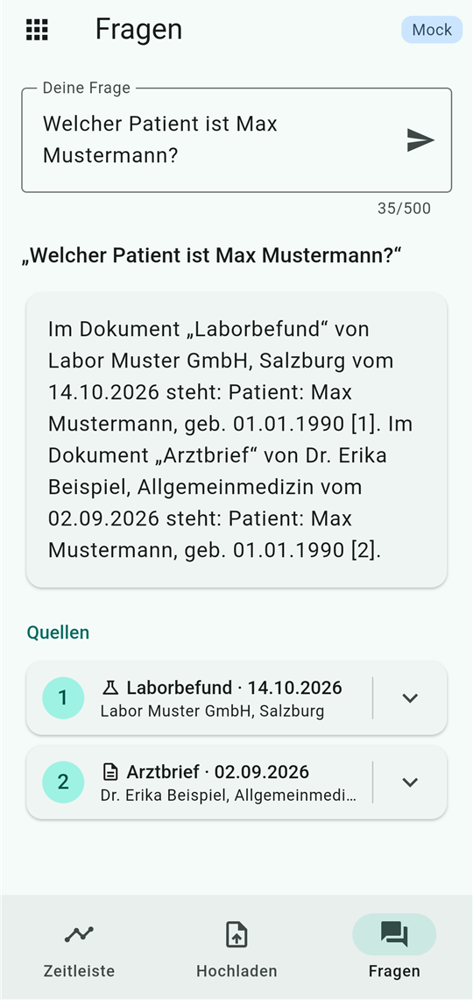
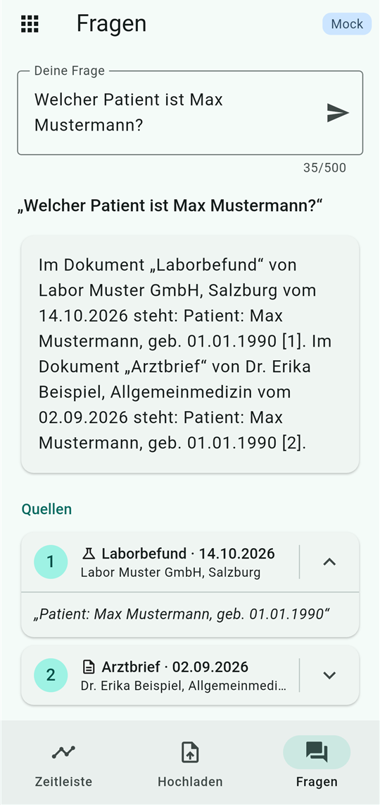

# Lifelog features

Status: 2026-11-12 · prototype

This document describes what Lifelog can do today: the screens of the app
and every function of app and platform, each with the same sections. The
contract between app and backend is [API.md](API.md); names follow
[GLOSSARY.md](GLOSSARY.md). If this document and API.md disagree, API.md
wins.

Each function has these sections:

- **What it does**: the function in one or two sentences.
- **Where**: where to find it in the app.
- **How to use**: the steps for the user.
- **Behind the scenes**: what app and backend do.
- **Limits**: what it does not do (yet), and known weaknesses.
- **Status**: done, in progress or open.

Status values: **Done** (backend and app), **Backend done, app in
progress** (Dylan is building the app side), **Open** (planned or proposed,
not built).

Parts the app does not show yet are marked like this; Dylan fills them in:

> **TODO (Dylan):** …

All examples use synthetic data. Display texts of the app are German and
quoted as they appear („Hochladen“).

## Contents

- [The app at a glance](#the-app-at-a-glance)
- Functions
  1. [Modules](#1-modules)
  2. [Take a photo](#2-take-a-photo)
  3. [Image and PDF upload](#3-image-and-pdf-upload)
  4. [Text import](#4-text-import)
  5. [Voice note](#5-voice-note)
  6. [Duplicate detection](#6-duplicate-detection)
  7. [Reading with Gemini](#7-reading-with-gemini)
  8. [Checking values with OCR (verification)](#8-checking-values-with-ocr-verification)
  9. [Correction](#9-correction)
  10. [Timeline with sorting](#10-timeline-with-sorting)
  11. [Entry](#11-entry)
  12. [Original](#12-original)
  13. [Delete](#13-delete)
  14. [Questions with sources](#14-questions-with-sources)
- [Privacy](#privacy)
- [Reliability](#reliability)
- [Measurements](#measurements)

---

## The app at a glance

The app is German, built with Flutter for iOS and Android. It opens on the
module overview; each module has the same three tabs.

```
Lifelog („Bereiche“, module overview)
└── Module, e.g. „Gesundheit“ (own color scheme)
    ├── Tab „Zeitleiste“ (timeline) ──────────┐
    ├── Tab „Hochladen“ (upload)              ├── Entry („Eintrag“)
    │     photo, image, PDF, text             │     ├── Original („Originaldatei“)
    └── Tab „Fragen“ (questions) ─ source ────┘     ├── correction dialogs
                                                    └── delete dialog
```

| Screen | Title in the app | Reached from | Shows |
|---|---|---|---|
| Module overview | „Lifelog“ | App start | One tile per module; inactive modules marked „Bald verfügbar“. A „Mock“ badge if the app runs without a backend. |
| Timeline | „Zeitleiste“ | Tab 1 of a module | All entries of the module on a time axis, grouped by month, with sort menu and order button |
| Upload | „Hochladen“ | Tab 2, or the button in the empty timeline | Buttons „Foto aufnehmen“, „Bild auswählen“, „PDF auswählen“, „Text eingeben“; preview; progress; errors |
| Questions | „Fragen“ | Tab 3 | Question field, answer, sources |
| Entry | type name, e.g. „Laborbefund“ | A row in the timeline, a source of an answer, a successful upload, a duplicate | Original preview, „Angaben“, „Erkannte Angaben“, „Volltext“; correction and delete |
| Original | file name | „Originaldatei öffnen“ or a tap on the preview in the entry | Image (zoomable), PDF (pages), or text |
| Dialogs | „Typ korrigieren“, „Datum wählen“, „Quelle korrigieren“, „<Fact> korrigieren“, „Eintrag löschen?“ | Pencil and trash buttons in the entry | Correct one value, or confirm deleting |

The tabs can also be switched by swiping. All three tabs stay alive while
the module is open: sorting, scroll position, a chosen file, a running
upload and the last answer are kept when switching.

**Mock mode:** without `--dart-define=API_BASE_URL=…` the app uses built-in
sample data (`MockApiClient`) and shows a „Mock“ badge, so nobody mistakes
sample data for real results. With `API_BASE_URL` it talks to the backend
(e.g. `http://10.0.2.2:8080` from the Android emulator).

---

## 1. Modules

### What it does

Lifelog is split into areas („Bereiche“) such as health, nutrition, recipes
and sport. Every entry belongs to exactly one module; timeline, upload and
questions only ever work within the open module.

### Where

Module overview („Lifelog“, start screen): one tile per module. The icon in
the top left of a module („Bereiche“) leads back.

### How to use

Tap the tile „Gesundheit“. The module opens in its own color scheme with
the tabs „Zeitleiste“, „Hochladen“ and „Fragen“. Tiles marked „Bald
verfügbar“ cannot be opened yet.

### Behind the scenes

- **App:** the modules are defined in `app/lib/module/module_catalog.dart`:
  ID, name, description, icon, color, allowed types, active or not. All
  modules use the same screens; a new module is a new item in that list.
  Each type has a display name, an icon and a color for its dot on the
  timeline (only to tell types apart, never to rate a value).
- **API:** upload, list and question take an optional `module` (default
  `health`); every entry stores it. The app always sends it explicitly.
- **Backend:** knows only `health`; its types are `doctor_letter`
  („Arztbrief“), `lab_report` („Laborbefund“), `prescription` („Rezept“)
  and `other` („Sonstiges“). The vision LLM may only choose a type of the
  module. Search only looks at chunks of the module.

### Limits

- Only `health` is usable. `nutrition`, `recipes` and `sport` are shown as
  „Bald verfügbar“; the backend answers other modules with `400`. Their IDs
  and types are not agreed yet.
- The module list is built into the app; later it could come from the
  backend.
- An entry's `module` cannot be corrected.
- Duplicate detection works across modules (the same file cannot be in two
  modules).

### Status

**Done** for `health`. Further modules: **Open**.

---

## 2. Take a photo

### What it does

Photographs a paper document with the phone camera and uploads it.

### Where

Tab „Hochladen“ → „Foto aufnehmen“.

### How to use

1. Tap „Foto aufnehmen“; the camera app opens.
2. Take the photo and confirm it.
3. Check the preview (file name and size below it). The X removes the photo,
   „Andere Datei wählen“ starts over.
4. Tap „Hochladen“. The rest is as in [image and PDF upload](#3-image-and-pdf-upload).

### Behind the scenes

- **App:** `image_picker` with the system camera. The photo is scaled to at
  most 3000 pixels on the long side and saved as JPEG with quality 85: small
  print stays readable and the file stays well below 10 MB. Android can end
  the app while the camera is open (low memory); the photo is recovered
  after the restart. If camera access is denied, the app says so („Kein
  Zugriff auf Kamera oder Fotos …“).
- **Backend:** like every image upload: the vision LLM reads it, OCR checks
  the values. Before OCR the photo is turned upright using its stored
  orientation (iPhones store portrait photos lying on the side plus
  „rotate by 90°“).

### Limits

- One photo is one page. A document with several pages is better uploaded as
  PDF.
- No cropping or perspective correction in the app. A photo showing much of
  the table around the sheet is read worse by OCR (measured in
  [docs/ocr](ocr/README.md), 2026-11-12: 71 % instead of 86 %).
- The photo keeps its EXIF data, possibly including the GPS position; see
  [privacy](#privacy).
- Photos of a screen work but are not the intended use (moiré; measured in
  [docs/ocr](ocr/README.md)).

### Status

**Done.**

---

## 3. Image and PDF upload

### What it does

Uploads an existing image or PDF. The backend reads it, checks the values
and stores it as a new entry on the timeline.

### Where

Tab „Hochladen“ → „Bild auswählen“ (photo library) or „PDF auswählen“
(files). The empty timeline also has a button „Dokument hochladen“.

### How to use

1. Choose an image or a PDF.
2. Check the preview: images as a thumbnail, PDFs with an icon, name and
   size. The preview prevents the wrong file from going to the cloud.
3. Tap „Hochladen“. A calm scan animation shows „Das Dokument wird
   ausgewertet. Das kann bis zu einer Minute dauern.“
4. On success the app says „Dokument gespeichert.“, switches to the
   timeline (scrolled to the top) and opens the new entry.
5. On an error a card explains it. For temporary errors (no connection,
   model overloaded, server error) the button becomes „Erneut versuchen“
   and the file stays; otherwise the file is discarded so another can be
   chosen.

The note at the top of the screen is always visible: „Dokumente werden zur
Auswertung an einen Cloud-Dienst gesendet. Bitte nur Testdokumente
verwenden.“

### Behind the scenes

- **App:** `image_picker` (library, same 3000 px / JPEG 85 as the camera)
  and `file_picker` (only `.pdf`). Files over 10 MB are rejected before
  uploading. Like the backend, the app recognizes the type from the first
  bytes (`api/mime_type.dart`): JPEG, PNG, HEIC, WebP (`RIFF` … `WEBP`) and
  PDF. `POST /api/v1/entries` as multipart with `file` and `module`, HTTP
  timeout 90 s.
- **Backend** ([API.md 3.1](API.md#31-upload-and-extract-a-file-or-text)):
  1. Check size (10 MB) and type from the content, not the file name: JPEG,
     PNG, HEIC, WebP, PDF.
  2. SHA-256 hash → [duplicate detection](#6-duplicate-detection), before any
     model call.
  3. [Reading with Gemini](#7-reading-with-gemini) and, at the same time,
     [reading the original locally](#8-checking-values-with-ocr-verification)
     (text layer or OCR).
  4. Check the extraction; drop incomplete facts.
  5. Split the full text into chunks of at most 500 characters and compute
     their embeddings.
  6. Compare the values with the original.
  7. Store original file (GridFS) → chunks → words of the original → entry.
     If a step fails, the parts already stored are removed: no half entry
     is left.
- Answer `201` with the full entry.

### Limits

- Synchronous: the app waits up to about a minute; there is no
  background upload.
- 10 MB per file, one file at a time.
- The app's hint names JPEG, PNG, HEIC, WebP and PDF („Erlaubt sind JPEG,
  PNG, HEIC, WebP und PDF bis 10 MB …“). The photo library usually returns
  JPEG or HEIC. Whether a WebP from the library arrives as WebP is not yet
  checked on the phone: `image_picker` scales and compresses the image
  (3000 px, quality 85) and may hand it over as JPEG. A WebP that arrives as
  WebP gets an image preview and is uploaded as `image/webp` (widget test).
- PDFs with more than 10 pages are stored, but not checked by OCR
  (`too_many_pages`).
- Android may not be able to show a HEIC preview; the app then shows an
  icon instead.

### Status

**Done.**

---

## 4. Text import

### What it does

Imports a document as text instead of a file, e.g. a note or text copied
from an e-mail. It becomes an ordinary entry.

### Where

Tab „Hochladen“ → „Text eingeben“.

### How to use

1. Tap „Text eingeben“; the field „Dokumentinhalt“ opens.
2. Type or paste the text (at most 100,000 characters; the counter shows
   the length).
3. Tap „Importieren“. „Abbrechen“ closes the field.
4. On success: „Text gespeichert.“, then the new entry opens as after an
   upload. After an error the text stays, so it can be changed or sent
   again.

### Behind the scenes

- **App:** `POST /api/v1/entries` with the field `text` instead of `file`.
- **Backend:** the text is taken exactly as it arrives (not even trimmed)
  and becomes `fullText`. A language model call returns date, issuer, type
  and facts (no `fullText`; the text is the full text). A text is always
  readable: if no type fits, it becomes `other`. It is stored as the
  original file `text.txt` (`text/plain; charset=utf-8`), so duplicate
  detection, fetching the original and deleting work as for a file. The
  values are checked against the text itself (verification source `text`).

### Limits

- 100,000 characters.
- One extra space makes a different hash, so a nearly identical text is not
  a duplicate.
- The full text cannot be corrected later (as for files).

### Status

**Done.**

---

## 5. Voice note

### What it does

Speak a note, e.g. a „spoken doctor's letter“ after a visit. The backend
turns the recording into text; the user checks and edits the text, and only
then is it saved as a [text import](#4-text-import).

### Where

Tab „Hochladen“ → „Sprachnotiz“ (microphone icon), below „Text eingeben“.
There are no extra screens: below the cloud notice, the tab changes from the
buttons to the recording, then to the waiting view, then to the text field
„Dokumentinhalt“ for checking.

The button follows `GET /status` (field `speech`), asked when the tab opens:

- `ok`: the button works, and the hint below the buttons ends with „… oder
  eine Sprachnotiz bis 5 Minuten.“
- `unavailable`, or `/status` cannot be reached: the button is greyed out,
  below it „Sprachnotizen sind gerade nicht verfügbar.“ and „Erneut prüfen“.
- `off`: no button.



### How to use

1. Tap „Sprachnotiz“. The first time, the phone asks for the microphone
   (Android: „Lifelog erlauben, Audioaufnahmen zu machen?“). If access is
   denied, a card says „Kein Zugriff auf das Mikrofon. Bitte in den
   Einstellungen des Geräts erlauben.“
2. The recording starts at once: a pulsing microphone, the running time and
   „Aufnahme läuft · höchstens 5 Minuten“. Speak the note.
3. Tap „Stopp“. „Abbrechen“ throws the recording away and goes back to the
   buttons. The recording also stops by itself at 4:58, just under the
   limit, and when the phone interrupts it (a call) or the app goes to the
   background; it then goes on as after „Stopp“.
4. Wait: „Die Sprachnotiz wird in Text umgewandelt. Das kann bis zu zwei
   Minuten dauern.“
5. Check the text. It is in the field „Dokumentinhalt“, below the card
   „Erkannter Text aus deiner Sprachnotiz. Bitte prüfen und bei Bedarf
   korrigieren, bevor du speicherst.“ and „Zahlen und Einheiten sind
   markiert. Bitte besonders genau prüfen.“ Every number and the word right
   after it are marked (bold on a light background), e.g. „400 Milligramm“,
   „2,5 Milliunits pro Liter“, „130/85 mmHg“, because a real but wrong
   unit („mL pro Liter“) is the mistake no check catches. Function words
   such as „nach“, „bis“ or „und“ are not taken as units („12.11.2026 nach
   …“ marks only the date).
   The marks follow the editing: a number typed in is marked at once. Text
   typed with „Text eingeben“ is not marked.
6. Correct what is wrong, then tap „Speichern“. From here on it is a
   [text import](#4-text-import): „Text gespeichert.“, then the new entry
   opens. The same text a second time gives „Diesen Text hast du schon
   importiert.“ with „Vorhandenen Eintrag öffnen“. „Abbrechen“ throws the
   text away; nothing is saved.

 

**Errors.** A card shows the message from the backend.

- No speech (`NO_SPEECH`: silence, only noise, or too short): „In der
  Aufnahme ist keine Sprache zu hören.“ The recording is deleted and the
  buttons come back; record again.
- Too long, too large, unreadable or an unknown format
  (`AUDIO_TOO_LONG`, `FILE_TOO_LARGE`, `UNREADABLE`,
  `UNSUPPORTED_FILE_TYPE`): the backend's message, e.g. „Die Aufnahme ist
  länger als 5 Minuten. Bitte kürzer sprechen oder aufteilen.“ The
  recording is deleted, as a second try would fail the same way.
- Temporary errors (no connection, server error, speech recognition not
  reachable, unexpected answer): the message plus „Erneut versuchen“, which
  sends the same recording again without speaking again, and „Verwerfen“.
- The phone cannot start or save the recording (`RECORDING_FAILED`): „Die
  Aufnahme konnte nicht gestartet werden. Bitte noch einmal versuchen.“ or
  „Die Aufnahme konnte nicht gespeichert werden. Bitte noch einmal
  aufnehmen.“

**The recording on the phone** lies in the app's temporary folder only as
long as it is needed: it is deleted as soon as the text has arrived, after
an error a retry cannot fix, on „Abbrechen“ and „Verwerfen“, when the module
is closed, and before each new recording.

In mock mode the text is always the same sample with numbers and units,
after about 3 seconds; what was said is not evaluated.

### Behind the scenes

- **API** ([API.md 3.9](API.md#39-transcribe-a-recording)):
  `POST /api/v1/transcriptions` with one recording in the field `audio`.
  The answer is only the text (`text`, `durationSeconds`, `language` `de`,
  `engine`). **Nothing is stored**: no entry, no recording, no duplicate
  check. The app then sends the (edited) text with `POST /entries` and
  `text`, and deletes the local recording. The app needs an HTTP timeout of
  at least 130 s for this call.
- **Formats:** M4A/MP4 (AAC, what iOS and the Flutter package `record`
  produce), 3GP, AMR, WAV, OGG, WebM, MP3, FLAC, recognized from the
  content. Recommended for the app: `record` with AAC-LC, mono, 16 kHz,
  about 32 kbit/s (about 240 KB per minute).
- **Backend pipeline** (`internal/speech`):
  1. Check size and format.
  2. `ffmpeg` converts to 16 kHz mono PCM. The recording lies in one
     temporary file (mode 0600) for these seconds and is deleted right
     after, also on errors.
  3. Check the length and the loudness: with less than 0.3 s of sound above
     the noise floor the answer is `NO_SPEECH`, and Whisper is not asked at
     all.
  4. **whisper.cpp** with the model **large-v3-turbo**, running **locally**
     as its own server on `127.0.0.1:8178` (open source, no cloud, no
     costs): language fixed to German, temperature 0, voice activity
     detection (only parts with speech are decoded), and a list of 45
     general medical terms as prompt (`whisper.Vocabulary`), so it writes
     „1-0-1“ instead of „101“ and knows terms like „Gonarthrose“.
  5. Remove known invented sentences („Untertitel im Auftrag des ZDF“) and
     repeated segments; if nothing is left, `NO_SPEECH`.
- whisper-server is started with `backend/scripts/whisper-server.sh` (macOS,
  Linux) or `.ps1` (Windows), which download and verify the models, warm the
  server up and restart it after a crash ([reliability](#reliability)).
- `GET /status` reports `speech`: `ok`, `unavailable` or `off`; the app can
  hide the microphone when it is not `ok`.

### Limits

- At most 10 MB and 5 minutes per recording; shorter than 0.5 s counts as no
  speech. Longer notes would need an asynchronous call.
- German only.
- **The text must be checked by the user.** Measured on 2026-11-12
  ([docs/speech](speech/README.md)): every number, value and date was
  right, but only 90 % of the key terms with a real voice (target 95 %),
  e.g. „plus 64“ for „Puls 64“, „keiner Guss“ for „kein Erguss“. The
  vocabulary prompt can also produce a plausible wrong unit („mL pro Liter“
  for „Milliunits pro Liter“).
- A saved voice note looks like any text import; it is not marked as spoken.
- Speed: 3 minutes of speech take about 7 s on an M3 Pro with GPU. On a
  Windows machine without a graphics card it is much slower (not measured).
- Silence and noise give `NO_SPEECH` (5 of 5 in the measurement), but this
  was tested with one speaker, one phone and synthetic noise.

### Status

**Backend done, app in progress** (Dylan).

---

## 6. Duplicate detection

### What it does

Prevents the same file (or the same text) from being stored twice, and
leads to the existing entry instead.

### Where

Tab „Hochladen“: an error card after „Hochladen“ or „Importieren“.

### How to use

Upload a file that is already stored. The card says „Diese Datei hast du
schon hochgeladen.“ (for a text: „Diesen Text hast du schon importiert.“)
and offers „Vorhandenen Eintrag öffnen“, which opens the existing entry on
the timeline.

### Behind the scenes

- The backend computes the SHA-256 hash of the file content (for a text:
  of its UTF-8 bytes) and looks it up **before** calling a model, so a
  duplicate costs no model call.
- A unique index on `file.sha256` in MongoDB also catches the same file
  uploaded twice at the same moment.
- Answer `409 DUPLICATE` with `details.entryId`; the app uses it for the
  button.

### Limits

- Only identical bytes count. A new photo of the same document, a scan
  instead of the PDF, or a text with one extra space is a new entry.
- Applies across all modules.
- After deleting an entry, the same file can be uploaded again.

### Status

**Done.**

---

## 7. Reading with Gemini

### What it does

Reads an uploaded document and extracts its document date, issuer, type,
full text and the facts in it (name, value, unit), e.g. „Hämoglobin“,
„14,2“, „g/dl“.

### Where

Not a screen of its own: it runs during every [upload](#3-image-and-pdf-upload)
and [text import](#4-text-import). The results are shown in the
[entry](#11-entry).

### How to use

Nothing to do; upload a document.

### Behind the scenes

- **Model:** `gemini-3.8-flash` (setting `GEMINI_MODEL`). It gets the file
  itself (image or PDF) and an English prompt, and answers with JSON that
  follows a fixed schema. For a text import, the same model classifies the
  text.
- **Rules in the prompt:** read only what is on the document; values exactly
  as written (`„<0,5“` stays a string); **no medical assessments,
  interpretations or recommendations**; the type must be one of the module.
- **Checks in the backend** (`core.CheckExtraction`): required fields, date
  format, allowed type. A single fact without name or value is dropped
  instead of rejecting the upload; the log then names the field, never the
  value. Facts get IDs `f1`, `f2`, … without gaps. If the model recognizes
  no document (e.g. a blurry photo), the answer is `422 UNREADABLE`; an
  answer that does not match the schema gives `502 EXTRACTION_FAILED`.
- **Search preparation:** the full text is split into chunks of at most 500
  characters (paragraphs first, then lines, then words), each embedded with
  `gemini-embedding-2` (768 dimensions) and stored for [questions](#14-questions-with-sources).
- **Retries and fallback:** on 429 (limit) or 503 (overloaded) up to two
  retries with growing waits; then, if set, a fallback model
  (`GEMINI_FALLBACK_MODEL`) gets one attempt. Reading has 50 s in total,
  20 s of which are reserved for the fallback, so a hanging main model
  cannot use up the time. Embeddings are retried but never switch model
  (vectors of different models are not comparable).
- **Replaceable:** the backend calls models only through the interfaces in
  `internal/llm` (`Reader`, `Embedder`, `Answerer`); another provider is a
  new implementation. The app never calls a model.

### Limits

- The vision LLM can misread or invent a value. That is why the values are
  [checked against the original](#8-checking-values-with-ocr-verification)
  and can be [corrected](#9-correction).
- The free tier of Gemini is used: Google may use the inputs to improve its
  products, so **only synthetic documents** may be uploaded. The free tier
  has request limits and is often overloaded (503).
- Changing the embedding model requires embedding all chunks again;
  otherwise search finds nothing useful.

### Status

**Done.**

---

## 8. Checking values with OCR (verification)

### What it does

A second, independent reader checks every value the vision LLM recognized
against the original: is this date, this issuer, this value with its unit
really on the document, and where? The user sees which values are
confirmed and can jump to their place in the original.

### Where

Only in the [entry](#11-entry): a card right under the original sums up
the check, and „Dokumentdatum“, „Quelle“ and every fact in „Erkannte
Angaben“ carry a mark. The timeline shows nothing, because the short form
has no verification (see [Timeline](#10-timeline-with-sorting), Limits).
„Typ“ and „Importiert“ are never checked and have no mark.

- **Confirmed** (`confirmed`): a small check mark right after the value.
  Screen readers read it as „Im Original gefunden“.
- **Unconfirmed** (`unconfirmed`): a grey line „Nicht im Original
  gefunden“ under the value. On purpose without a warning color: the value
  could not be found in the original, which does not mean it is wrong.
- **Corrected** (`corrected_confirmed`, `corrected_unconfirmed`): no
  second mark; the result is added to the existing correction hint, e.g.
  „Wert korrigiert, erkannt: 6,3 · im Original gefunden“ or „Wert
  korrigiert, erkannt: 2 · nicht im Original gefunden“.
- **Unchecked entry** (`unchecked`): the card says „Nicht geprüft“ with one
  neutral sentence for the `reason`, and no value has a mark. An entry
  without `verification` (older backend) counts as `not_run`.

| `reason` | Sentence in the card |
|---|---|
| `ocr_unavailable` | „Die Prüfung ist auf diesem Server nicht eingerichtet.“ |
| `ocr_failed` | „Das Original konnte beim Prüfen nicht gelesen werden.“ |
| `unsupported_file_type` | „Dieser Dateityp kann nicht geprüft werden.“ |
| `too_many_pages` | „Das PDF hat mehr als 10 Seiten und wird deshalb nicht geprüft.“ |
| `image_too_large` | „Das Bild ist zu groß, um es zu prüfen.“ |
| `no_text` | „Im Original wurde kein lesbarer Text gefunden.“ |
| `not_run` or unknown | „Dieser Eintrag wurde noch nicht geprüft.“ |

  

### How to use

1. Open an entry. The card under the original shows how many values were
   found, e.g. „5 von 6 Werten im Original gefunden (83 %)“, and what they
   were compared against: „Abgleich mit der Textebene des PDF“, „Abgleich per
   Texterkennung im Foto“ (or „… im gescannten PDF“), „Abgleich mit dem
   eingegebenen Text“ or, for a PDF with digital and scanned pages,
   „Abgleich mit Textebene und Texterkennung im PDF“. If the user corrected
   values, „· 1 Wert korrigiert“ follows.
2. The info button („Was bedeutet die Prüfung?“) opens a short
   explanation, „So prüft Lifelog die Werte“: what found and not found
   mean, that type and import date are not checked, that the check is no
   medical assessment, and which program checked when.
3. Look at the values without a check mark in the original („Originaldatei
   öffnen“). If one is wrong, correct it with the pencil
   ([Correction](#9-correction)). The app shows the check from the
   backend's response right away: the card and the mark of the value
   change, e.g. to „4 von 6 Werten im Original gefunden (67 %)“.
4. The jump from a value to its place in the original is not built yet
   ([Original](#12-original)); the app already reads the `locations`.

### Behind the scenes

- **API:** every full entry carries `verification`
  ([API.md, verification](API.md#verification)): `status` `checked` or
  `unchecked` (with a `reason`), `source`, `engine`, `confirmed`,
  `corrected`, `total`, `matchPercent`, and per field its `status`
  (`confirmed`, `unconfirmed`, `corrected_confirmed`,
  `corrected_unconfirmed`), the OCR `confidence` and up to three
  `locations`: rectangles on a page as fractions of width and height (for a
  text import, a range in `fullText`).
- **Three sources, all local, open source, no model call:**
  - `pdf_text`: PDF pages with a text layer: words and positions straight
    from the PDF (`pdftotext`, Poppler). Exact.
  - `ocr`: photos and scanned PDF pages: Tesseract (`deu`) at 300 dpi; PDF
    pages are rendered with `pdftoppm`. Photos are turned upright and scaled
    to a long side between 2500 and 4096 pixels first.
  - `text`: a text import is compared with the entered text.
  A page counts as having a text layer from 20 characters; this is decided
  per page.
- **Runs in parallel** to the vision LLM, so it adds no waiting time; limit
  30 s. A failed check never fails the upload: the entry is stored
  `unchecked` with a reason (`ocr_failed`, `too_many_pages`, `no_text`, …).
- **Comparison** (deterministic, tested): normalized words (case, dashes,
  punctuation at the edges, decimal comma = point), whole words only (`4`
  is not found inside `14`), the date in all common German forms (also
  „Jänner“), the issuer as a whole or each comma-separated part, the value
  with its unit in the same visual line, a short value only in the line of
  its name.
- The words with positions are stored (collection `ocr`), so after a
  [correction](#9-correction) the entry is checked again without a new OCR
  run.
- `go run ./cmd/ocrcheck` fills in old entries (`-write`), rechecks all
  (`-recheck -write`) and measures OCR on `demo/`.

### Limits

- **Strict:** a fact only counts with value **and** unit. Tesseract reads
  `mg/dl` on photos as `mgj/dl`, so such a fact is `unconfirmed` although
  its value is right. Two ways out are proposed, neither built
  ([docs/ocr](ocr/README.md), „Open point: values with a misread unit“).
- Measured ([docs/ocr](ocr/README.md)): PDFs with a text layer 100 %; the
  synthetic demo photos 93 % after scaling up; the first real photo of
  paper 86 % with every value right (one unit misread).
- „Confirmed“ means the value is on the document, not that the vision LLM
  assigned it to the right name in every case.
- Only the first 10 pages of a PDF; images up to 50 megapixels.
- A text layer made by a scanner's own OCR counts as `pdf_text`. Rotated PDF
  pages are not tested.
- Entries from before 2026-11-11 are `unchecked`/`not_run` until
  `cmd/ocrcheck -write` runs.

### Status

**Backend done, app in progress** (Dylan: showing the check and jumping to
the place).

---

## 9. Correction

### What it does

Lets the user fix a wrongly recognized value. The originally recognized
value is kept and stays visible.

### Where

[Entry](#11-entry): the pencil button next to „Typ“, „Dokumentdatum“,
„Quelle“ and every fact in „Erkannte Angaben“.

### How to use

1. Tap the pencil next to the value.
2. Change it in the dialog:
   - **Typ:** pick from the types of the module.
   - **Dokumentdatum:** „Datum wählen“ (date picker), „Datum entfernen“, or
     „Erkanntes Datum wiederherstellen“.
   - **Quelle:** edit the text; an empty field removes the issuer.
   - **Fact:** value („Genau wie auf dem Dokument, z. B. „<0,5““; must not
     be empty) and unit (empty = no unit). „Erkannten Wert übernehmen“ puts
     the recognized value back.
3. „Speichern“. The app shows „Korrektur gespeichert.“; under the value it
   says e.g. „korrigiert, erkannt: 6,3“.

### Behind the scenes

- **App:** one `PATCH /api/v1/entries/{id}` per dialog with only the changed
  fields; afterwards it shows exactly the entry the backend returns.
- **Backend** ([API.md 3.5](API.md#35-correct-recognized-values)):
  - The fields always hold the current value; `corrections` holds at most
    one item per field with the originally `recognized` value, the
    `corrected` value and `correctedAt`.
  - Setting a field back to the recognized value removes its correction.
  - A request whose values already apply changes nothing.
  - After a change the [verification](#8-checking-values-with-ocr-verification)
    runs again against the stored words: a corrected value that is on the
    document becomes `corrected_confirmed`, otherwise
    `corrected_unconfirmed`.
  - These rules are deterministic and tested.

### Limits

- The full text cannot be corrected („Der Volltext kann im Prototyp nicht
  korrigiert werden.“). Search and answers use the full text, so a corrected
  fact does not change answers.
- Facts cannot be added, deleted or renamed; `module` cannot be changed.
- Two corrections of the same entry at the same moment: the second wins
  (no lock).
- No length limit per field, only 64 KiB for the whole request.

### Status

**Done.** Correcting the full text: **Open** (planned in API.md, section 4).

---

## 10. Timeline with sorting

### What it does

Shows all entries of a module on a time axis, newest first by default,
grouped by month.

### Where

Tab „Zeitleiste“ (first tab of a module).

### How to use

- Each row shows the type (icon and colored dot on the axis), the issuer
  („Quelle unbekannt“ if none) and the date. Tap a row to open the
  [entry](#11-entry).
- Sort menu: „Nach Dokumentdatum“ or „Nach Importdatum“. With the import
  date, the row also shows „Importiert: …“.
- The order button switches between „Neueste zuerst“ and „Älteste zuerst“.
- Pull down to reload.
- Entries without a document date are collected under „Ohne Datum“ at the
  end.
- Empty module: „Noch keine Dokumente.“ with a button „Dokument hochladen“.

### Behind the scenes

- **App:** `GET /api/v1/entries?module=…&sort=…&order=…`. The app never
  sorts itself; it only groups the received order into months (document
  date as a plain date, import time in local time). If the sort is changed
  quickly, only the latest response counts. After an upload or a deletion
  the list reloads.
- **Backend** ([API.md 3.2](API.md#32-list-entries-for-the-timeline)):
  the short form (`id`, `module`, `type`, `documentDate`, `importedAt`,
  `issuer`), sorted by the chosen field; with `documentDate`, entries
  without a date always come last; ties are broken by `importedAt`, then
  `id`, so the order is always the same. Tested.
- `documentDate` is a plain date without a time zone, so a report from
  14 October is always shown on 14 October.

### Limits

- No pagination: the list always holds all entries of the module.
- No filter by type, no text search in the timeline (use
  [questions](#14-questions-with-sources)).
- The short form has no verification result, so the timeline cannot mark
  unconfirmed entries (proposed in API.md, section 4).

### Status

**Done.**

---

## 11. Entry

### What it does

Shows everything Lifelog knows about one document: the original, the
recognized details, the facts and the full text.

### Where

Tap a row in the timeline, a source of an answer, or „Vorhandenen Eintrag
öffnen“ after a duplicate. A successful upload opens it automatically.

### How to use

From top to bottom:

- **Original:** a preview for images (tap to enlarge), name and size for
  PDFs and texts, and „Originaldatei öffnen“ ([Original](#12-original)).
- **„Angaben“:** „Typ“, „Dokumentdatum“, „Quelle“, „Importiert“.
- **„Erkannte Angaben“:** every fact with „Wert“ and „Einheit“, or „Keine
  Angaben erkannt.“
- **„Volltext“:** the full text, selectable.
- Pencil buttons to [correct](#9-correction), the trash button in the app
  bar to [delete](#13-delete).
- „Zurück“ leads to where the entry was opened from (timeline or answer).

**Verification marks** ([section 8](#8-checking-values-with-ocr-verification)):
between the original and „Angaben“ a card sums up the check („5 von 6
Werten im Original gefunden (83 %)“, or „Nicht geprüft“ with the reason) and has
an info button for the explanation. „Dokumentdatum“, „Quelle“ and every
fact carry a small check mark if the value was found in the original, or
the grey line „Nicht im Original gefunden“ if not. A corrected value shows
the result in its correction hint („… · im Original gefunden“). After a
correction both come from the backend's response.

### Behind the scenes

- `GET /api/v1/entries/{id}` returns the full entry (API.md section 2),
  including `corrections` and `verification`. The app shows the current
  values as they come and marks corrected fields from `corrections`; it
  computes nothing itself.
- For images the original is loaded once for the preview and reused when
  it is opened.

### Limits

- Read-only except for the correctable fields (see [correction](#9-correction)).
- No sharing or exporting of an entry.

### Status

**Done**; verification display **in progress** (Dylan).

---

## 12. Original

### What it does

Shows the uploaded original file, so the recognized values can be compared
with the document itself.

### Where

[Entry](#11-entry) → „Originaldatei öffnen“, or a tap on the image preview.

### How to use

- **Image:** pinch to zoom, drag to move.
- **PDF:** the pages one below the other, zoomable.
- **Text import:** the text, selectable and scrollable.

**Jump to a value in the original:**

> **TODO (Dylan):** where the jump starts (a value in the entry, a mark of
> the verification), how the place is shown (page, highlighted rectangle)
> and how to get back.

### Behind the scenes

- `GET /api/v1/entries/{id}/file` returns the file exactly as uploaded
  (stored in MongoDB GridFS), with `Content-Disposition` (RFC 6266),
  `X-Content-Type-Options: nosniff` and `Cache-Control: private, no-store`,
  so the original does not end up in any cache.
- **App:** images with Flutter's `Image` in an `InteractiveViewer`, PDFs
  with `pdfx` (the PDF functions of Android and iOS), texts decoded as
  UTF-8 (a broken byte becomes „�“ instead of an error; a BOM is removed).
- **For the jump:** `verification.fields[].locations` give the page and a
  rectangle as fractions of the page (0–1, origin top left), independent of
  the resolution. For photos they refer to the photo shown upright (EXIF or
  HEIC rotation applied), which is also how Flutter shows it. For a text
  import a location is a range `start`/`end` in `fullText` (Unicode code
  points).

### Limits

- Android may not be able to show HEIC; the app then says „Das Bild kann
  auf diesem Gerät nicht angezeigt werden.“
- The file is loaded again every time (no offline copy, on purpose).
- No download or sharing of the original.
- References `[n]` of an answer do not lead to a place in the original yet;
  a design is proposed in API.md, section 4.

### Status

Showing the original: **Done.** Jumping to a value: **Backend done, app in
progress** (Dylan).

---

## 13. Delete

### What it does

Deletes an entry completely: entry, original file, search chunks and the
stored words of the original.

### Where

[Entry](#11-entry) → trash button in the app bar („Eintrag löschen“).

### How to use

1. Tap the trash button.
2. Confirm „Eintrag löschen?“ („Eintrag, Originaldatei und Suchabschnitte
   werden endgültig gelöscht.“) with „Löschen“, or „Abbrechen“.
3. The app says „Eintrag gelöscht.“, closes the entry and reloads the
   timeline.

### Behind the scenes

- `DELETE /api/v1/entries/{id}` → `204`.
- The backend deletes in this order: chunks with embeddings, the words of
  the original (collection `ocr`), the original file, **the entry last**.
  If a step fails, the answer is `500` and the entry stays visible; deleting
  again removes the rest. If the app drops the connection after deleting has
  started, it still runs to the end (own time limit of 30 s).
- Afterwards the same file can be uploaded again.

### Limits

- No undo, no recycle bin.
- One entry at a time.
- Deleting the same entry twice gives `404`.

### Status

**Done.**

---

## 14. Questions with sources

### What it does

Answers a question about the user's own documents, only from what is in
them, always with the sources. If nothing matches, the answer is always
„Dazu finde ich nichts in deinen Dokumenten.“

### Where

Tab „Fragen“.

### How to use

1. Type the question in „Deine Frage“ (at most 500 characters) and send it.
   The hint below says that the answer is based only on the uploaded
   documents.
2. While searching: „Suche in deinen Dokumenten …“.
3. The answer appears with references like [1]; below it „Quellen“: one
   compact card per source (see below).
4. Tap a source to open its entry; „Zurück“ leads back to the answer.
5. On an error: „Erneut versuchen“.

**Compact sources:**

- Each source is one line: the number as in the answer text, the type
  icon, „Typ · Datum“ (e.g. „Laborbefund · 14.10.2026“) and the issuer
  below it. A long issuer is shortened with „…“. The excerpt is hidden.
- The card has two separate tap targets, divided by a thin vertical line:
  - **Left part:** opens the entry.
  - **Arrow on the right** (tooltip „Auszug anzeigen“): shows the excerpt
    the answer is based on below the line, in italics and quotation marks.
    The arrow turns up („Auszug ausblenden“) and hides it again. Expanding
    never opens the entry.
- Every card expands on its own. A new answer starts with all cards
  collapsed; after „Zurück“ from an entry the cards stay as they were.
- The number always comes from the backend, so gaps (e.g. only 1 and 3)
  stay correct.
- Screen reader: the left part reads e.g. „Quelle 1: Laborbefund,
  14.10.2026, Labor Muster GmbH, Salzburg“ with the hint „Eintrag
  öffnen“; the arrow reads „Auszug von Quelle 1 anzeigen“ (or
  „… ausblenden“) and reports whether it is expanded.

 

### Behind the scenes

- `POST /api/v1/questions` with `question` and `module`
  ([API.md 3.6](API.md#36-ask-a-question)), HTTP timeout 60 s.
- **Retrieval (RAG):**
  1. Embed the question (`gemini-embedding-2`).
  2. Atlas Vector Search finds the 5 best chunks of the module.
  3. **First layer:** chunks with a score below **0.82** are dropped, as are
     chunks whose entry no longer exists. If none is left, the backend
     answers with the fixed sentence **without** calling the language model.
  4. The language model gets the question and only these chunks. It must
     answer only from them, in German, with references `[n]`, and gives no
     medical assessments (no „normal“, „erhöht“, no advice).
  5. **Second layer:** an answer without a valid reference counts as
     nothing found (fixed sentence, `found: false`). An answer without
     sources never reaches the app.
- `sources` only lists the chunks the answer cites; the numbers match the
  references (they can have gaps, e.g. 1 and 3). Date and issuer of a source
  show the current, corrected values.
- The threshold 0.82 was calibrated with `cmd/calibrate` on the demo data
  (45 questions): relevant questions scored 0.830–0.902, unrelated ones up
  to 0.808 ([docs/calibration](calibration/)).
- Answering has 45 s; retries and fallback as for
  [reading](#7-reading-with-gemini).

### Limits

- Answers come from the full text, not from corrected facts.
- One question at a time, no follow-up questions with context.
- The threshold was calibrated on synthetic data with a margin of 0.012;
  letterheads and addresses in chunks can make unrelated questions score
  close to it (e.g. questions mentioning „Salzburg“).
- A reference leads to the entry, not yet to the place in the original
  (proposal in API.md, section 4).
- The question and the matching chunks are sent to Gemini (see
  [privacy](#privacy)).

### Status

**Done**, including compact sources.

---

## Privacy

Lifelog is meant for health documents, so privacy rules apply to every
function. In the prototype **only synthetic test documents** are used; real
health data must not be uploaded.

### What leaves the backend

| Data | Goes to | Why |
|---|---|---|
| Uploaded file or entered text | Google Gemini (cloud) | Reading (date, issuer, type, facts, full text) |
| Chunks of the full text | Google Gemini (embedding model) | Search vectors |
| Question and the matching chunks | Google Gemini | Embedding the question, writing the answer |
| Everything that is stored | MongoDB Atlas (cloud, free tier) | Storage |

Gemini is used in the free tier, where Google may use inputs to improve its
products. This is the main reason for the synthetic-data rule. The upload
screen always shows: „Dokumente werden zur Auswertung an einen Cloud-Dienst
gesendet. Bitte nur Testdokumente verwenden.“

### What stays local

- **OCR / verification:** Poppler and Tesseract run on the backend machine;
  no model call.
- **Speech recognition:** whisper.cpp runs on the backend machine, reachable
  only on `127.0.0.1`. Recordings are **never stored**: they exist in memory
  and, for a few seconds, in one temporary file (mode 0600) that is deleted
  right after. The app is asked to delete its local recording too.
- The app never calls a model directly; every call goes through the backend.

### What is stored, and deleting

MongoDB: the entry (`entries`), its chunks with embeddings (`chunks`), the
words of the original with positions (`ocr`), and the original file (GridFS
bucket `originals`). [Deleting](#13-delete) removes all four. Corrections
keep the originally recognized value inside the entry; it is deleted with
it.

### Logs

The backend logs method, path, status, duration, sizes, counts and error
kinds, **never values or text**: no fact values, no full text, no
questions or answers, no transcripts. A dropped fact is logged by its field
name only (`facts[2].value`). whisper-server logs only the fixed file name
`audio.wav` and the length, never the text (checked).

### Secrets

API key and database access are only in `.env` (git-ignored, never
committed); `.env.example` lists the variables without values. The API key
is masked as `***` in error messages (`config.Mask`). The repository is
public; its history was checked with gitleaks.

### Network

- The backend listens on `127.0.0.1:8080` by default. For a phone on the
  Wi-Fi it can listen on all interfaces (`ADDRESS=0.0.0.0`), only for
  testing: the prototype has **no login and no TLS**.
- The original file is sent with `Cache-Control: private, no-store` and
  `nosniff`.

### No medical assessments

Read and answer prompts forbid medical assessments, interpretations and
recommendations; the app only shows what is in the documents.

### Limits and open points

- **Photo metadata:** photos keep their EXIF data, possibly including the
  GPS position; it goes to Gemini and is stored. Proposed: the backend
  removes it before storing (API.md, section 4).
- iOS voice memos contain Apple's own transcript and a UUID inside the file
  ([docs/speech](speech/README.md)); the backend ignores them and stores
  nothing, but the file on the phone keeps them.
- One user, no login, no encryption beyond what Atlas provides; login and
  per-user data are open points (API.md, section 4).

### Status

Rules above: **Done.** Removing photo metadata, login and TLS: **Open.**

---

## Reliability

What happens when something fails, and how Lifelog avoids half or wrong
states.

### No half entries

- **Upload:** file → chunks → words → entry; the entry comes last. If a step
  fails, the parts already stored are removed (with their own 10 s time
  limit, even if the request was canceled). If the app loses the connection
  during an upload, either a complete entry exists or nothing.
- **Delete:** entry last; a repeated delete cleans up the rest; deleting
  continues if the app disconnects.
- **Duplicates:** the unique index on the hash also holds for two uploads at
  the same moment.

### Model failures

- Gemini on 429/503: up to two retries with growing waits, then the
  optional fallback model with a reserved share of the time limit
  (reading 50 s, answering 45 s). If all fail: `503 MODEL_UNAVAILABLE`, and
  the app offers „Erneut versuchen“ with the same file or question.
- An answer of the vision LLM that does not match the schema:
  `502 EXTRACTION_FAILED`; nothing is stored.
- Questions: two layers (score threshold, then valid references) make sure
  an answer without sources never reaches the user.

### Verification never blocks

OCR runs in parallel with its own 30 s limit. If it fails or a program is
missing, the entry is stored `unchecked` with a reason; the upload succeeds.

### Speech recognition

- The backend starts even if `ffmpeg` or whisper-server is missing; then
  `/status` says `speech: "unavailable"` and transcriptions answer 503.
- The start scripts warm whisper-server up after the start and start it
  again after a crash (2 s, doubling up to 60 s). A crash during a
  transcription gives that request 503; afterwards the status returns to
  `ok` by itself (tested with `kill -9`, 2026-11-12).
- Known bug of whisper.cpp 1.9.5: a fresh server crashed on a silent first
  recording ([#4156](https://github.com/ggml-org/whisper.cpp/issues/4156),
  fixed upstream after 1.9.5). The backend avoids it with
  `no_language_probabilities=true`.

### Health check

`GET /api/v1/status` checks the database (HTTP 503 if unreachable) and
reports `speech` separately, without any model call.

### Time limits

| Where | Limit |
|---|---|
| Server: reading a request / writing a response | 60 s / 150 s |
| Reading with Gemini (incl. fallback reserve) | 50 s |
| Answering a question | 45 s |
| OCR of the original | 30 s |
| Transcription | 120 s |
| Delete | 30 s |
| App: list, entry, correction / question, file / upload | 20 s / 60 s / 90 s |
| App: transcription (required by API.md) | at least 130 s |

### In the app

- Temporary errors (no connection, 500, 502, 503, unexpected response) keep
  the chosen file or text and offer „Erneut versuchen“; a typed text is
  never lost after an error.
- All three tabs keep their state; a photo taken while Android ended the app
  is recovered.
- When the sort changes quickly, only the last response is shown.
- A response that does not match the contract becomes a clear error
  (`UNEXPECTED_RESPONSE`) instead of a crash.

### Limits

- Everything is synchronous; long uploads or recordings block one request.
- One backend instance; whisper-server runs on the same machine.
- The Gemini free tier is often overloaded or limited; the retries help but
  cannot guarantee an answer.
- No backup strategy is defined for the prototype.
- The Windows start script for whisper-server is not tested.

### Status

**Done** as described; asynchronous uploads and backups: **Open.**

---

## Measurements

| Topic | Command | Reports |
|---|---|---|
| OCR (verification) | `go run ./cmd/ocrcheck` | [docs/ocr/README.md](ocr/README.md) and the dated reports there |
| Speech recognition | `go run ./cmd/speechcheck` | [docs/speech/README.md](speech/README.md) and the dated reports there |
| Search threshold | `go run ./cmd/calibrate` | [docs/calibration/](calibration/) |
